# Using Research Desk

This guide walks through the dashboard at <http://127.0.0.1:3001>. To install it, see the quick start in the
[README](../README.md#quick-start) or [SETUP.md](SETUP.md).

The idea in one line: **you give it a goal, it builds a library of sources for you, and writes a short report in which
every sentence points at the passage it came from.** You review the sources and sentences, and your ratings are kept.

> **Your first run.** Start with `uv run scripts/start.py` (it opens the dashboard). Go to **Research**, type a goal
> such as *"What do practitioners recommend for chunking documents in RAG systems? Cover chunk size, overlap and
> tables."*, answer or skip the questions, and on the plan choose **Yes, gather new reading** (your library starts
> empty). Tick 10-20 good sources, press **Collect**, and leave it: expect 20-40 minutes on a laptop, mostly converting
> PDFs and writing. The report then opens with every sentence linked to its source.

Contents: [Front page](#front-page) · [Start a research run](#start-a-research-run) · [Follow a run](#follow-a-run) ·
[Read a report](#read-a-report) · [Give feedback](#give-feedback) · [The library](#the-library) ·
[Settings](#settings) · [Other pages](#other-pages) · [Where files go](#where-files-go) · [Tips](#tips)

---

## Front page

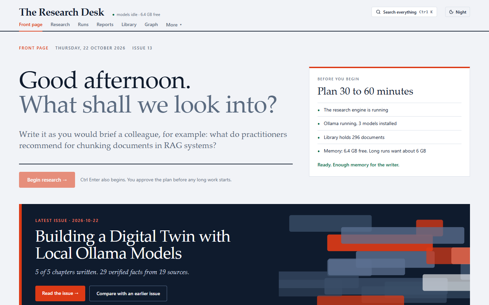

On a new install, with nothing in the library yet, the front page instead shows *Nothing on the desk yet* and three
steps (add sources, ask a question, read your first issue); the machine checks are then on the **Research** page.

- **Before you begin** checks the machine: is the research engine (backend) running, is Ollama up with the models,
  how big your library is, and whether there is enough free memory (a run uses about 11-12 GB).
- Type a goal and press **Begin research →** (or Ctrl+Enter). This only fills in the goal on the Research page;
  nothing starts until you press Begin there.
- **Latest issue** opens your newest report. Runs that are waiting for you appear under *Continue where you left off*.

The top bar: **Research** (start a run), **Runs**, **Reports**, **Library**, **Graph** (knowledge graph), and **More**
(Compare issues, Pipeline graph, Quick research, Profile, Settings). **Search everything** (Ctrl K) searches reports
and library titles.

---

## Start a research run

A run has six steps, shown across the top of the Research page: **Brief → Questions → Plan → Sources → Progress →
Report**. Three of them pause and wait for you; a run keeps its place if you close the page.

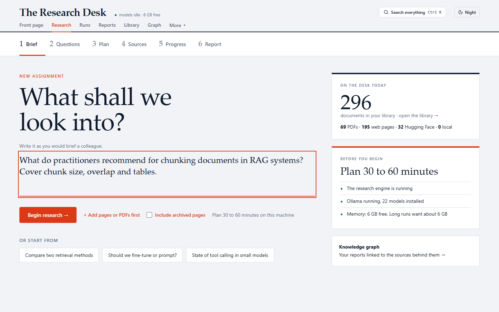

### 1. Brief

Write the goal as you would brief a colleague: what you want to know and what it should cover.
Good: *"What do practitioners recommend for chunking documents in RAG systems? Cover chunk size, overlap and tables."*
Too vague: *"RAG"*.

- **+ Add pages or PDFs first**: paste addresses (one per line) you already know are useful. They are fetched after
  you approve the plan.
- **Include archived pages**: also search your older archived copies.
- Press **Begin research →**.

### 2. Questions

It may ask up to four clarifying questions, one at a time ("Question 1 of 4"). Answer briefly, or leave a question
blank and it decides. **Next question →**, **Back**, **Finish questions →**, or **Skip all**.

### 3. Plan

It splits the goal into sub-questions (one report chapter each) and shows, for every question, what your library
already holds: **covered**, **thin: one document** or **nothing in the library**. Click a question to see the
documents behind it.

- **Gather new reading first?** Choose *Yes, for the questions the library covers poorly* (the default when there are
  gaps), *Yes, for every question*, or *No, use the library as it is*. Your first runs need collecting: the library
  starts empty.
- **Ask for changes**: type what to change (*"add a section on cost, drop the history of RAG"*) and **Revise plan**.
  Up to two revisions; questions cannot be edited one by one.
- **Approve →** starts the long part.

### 4. Sources

If you chose to collect, it searches the web (DuckDuckGo or your SearXNG), arXiv, Europe PMC and Hugging Face, then
shows what it found in two columns, **Papers and PDFs** and **Web pages**. Each card has a relevance score (0-3, scored
by the model), the question it is for, and **Preview**.

- Cards scoring 3/3 are ticked for you. Tick or untick, or use **tick all** / **clear**.
- **Collect N sources →** fetches and indexes them; **Skip collecting** uses the library as it is.
- PDFs take a few minutes each to convert. Fewer, better sources give a faster run.

### 5. Progress

A bar shows the stage (Library, Questions, Plan, Sources, Evidence, Writing, Saved), with counts of questions answered,
passages kept and sources collected, and a live **Newswire** of the last events. **Stop this run** stops it within
seconds (what was found so far is kept). You can leave the page; the run continues.

### 6. Report

When it is saved: **Open the report →**. A typical report takes 6-30 minutes and is 1,000-3,500 words.

---

## Follow a run

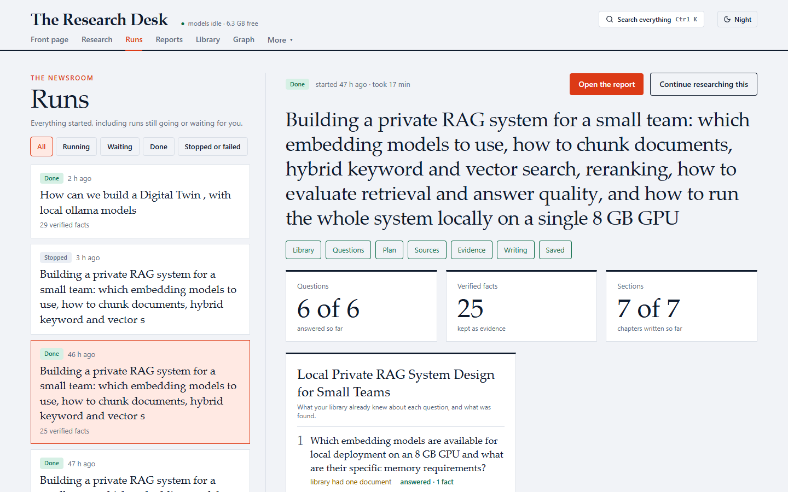

**Runs** lists every run with filters (All, Running, Waiting, Done, Stopped or failed). Select one to see:

- its stage, the questions it asked you and your answers, and each plan question with how much evidence was found;
- the **Newswire** and what was collected (and why other sources were skipped);
- buttons: **Open to answer the questions / choose sources / review the plan** (when it waits for you),
  **Stop this run**, **Open the report**, **Continue researching this** (a new run that reuses the collected sources),
  **Start this goal again** (for a stopped or failed run; this starts a fresh run).

---

## Read a report

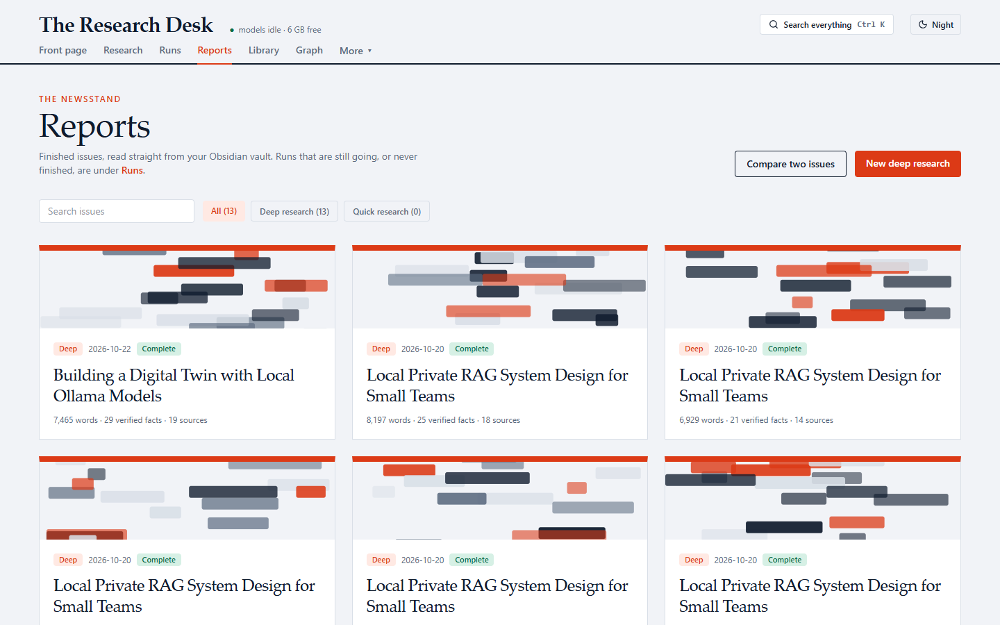

**Reports** shows every finished report with its date, words, passages and sources. Search, filter, or
**Compare two issues**.

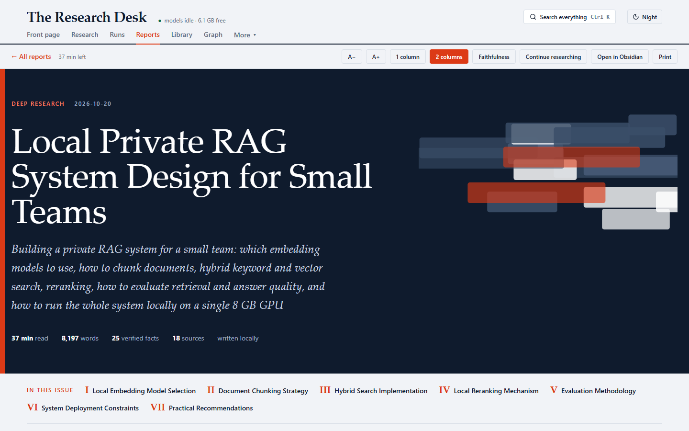

A report opens with its goal, size and chapters. The toolbar: text size (**A−** / **A+**), **1 column** /
**2 columns**, **Faithfulness** (a summary of the checks), **Continue researching**, **Open in Obsidian**, **Print**.

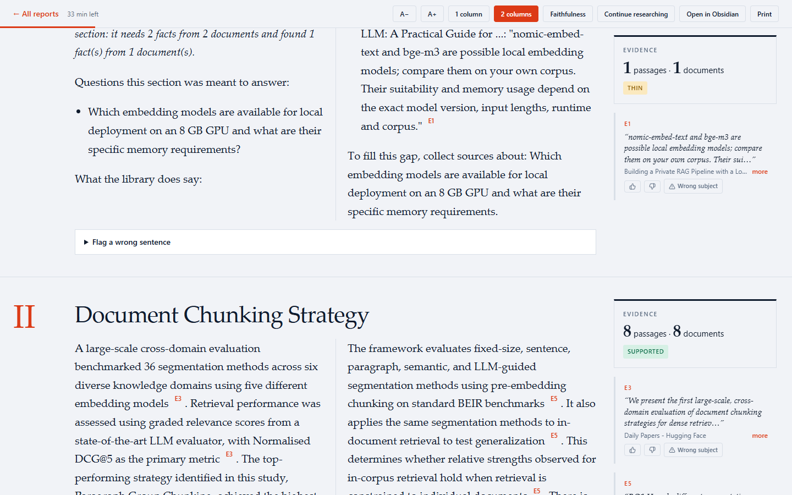

Each chapter answers one sub-question:

- Every sentence ends with a citation like **E3**. Click it and its passage is highlighted in the right margin, with
  the document › section it came from; **more** shows the full passage.
- The **Evidence** box says how many passages and documents stand behind the chapter: **supported**, **thin** or
  **no evidence**. A chapter without enough evidence says so in a line and suggests what to collect
  (**Collect sources for this gap**) instead of guessing.
- Sentences that failed a code check carry a red chip: **check figure** (a number is not in the cited passage),
  **check subject** (a model name or size is not in it), **check wording** (the sentence's words are barely in it),
  **check domain** (the source is from a specific field, e.g. medical, and the sentence does not say so). An amber
  **inference** chip marks a sentence with no citation. Unmarked cited sentences passed every check.
- Select any text (12-400 characters) for **Copy as citation** or **Research this deeper**.

At the end: **Where every claim came from** lists the sources (papers, other, web pages) with **Copy citation**.

---

## Give feedback

Feedback is stored with the run and the engine version, so later changes can be compared against your ratings.

- **Each passage** in the margin: 👍 *Relevant*, 👎 *Not relevant*, ⚠ *Wrong subject* (true, but about a different model,
  size or topic than the sentence claims). Click again to clear.
- **Each sentence**: open **Flag a wrong sentence** under a chapter and press **This is wrong** on any sentence; add a
  short reason if you like.

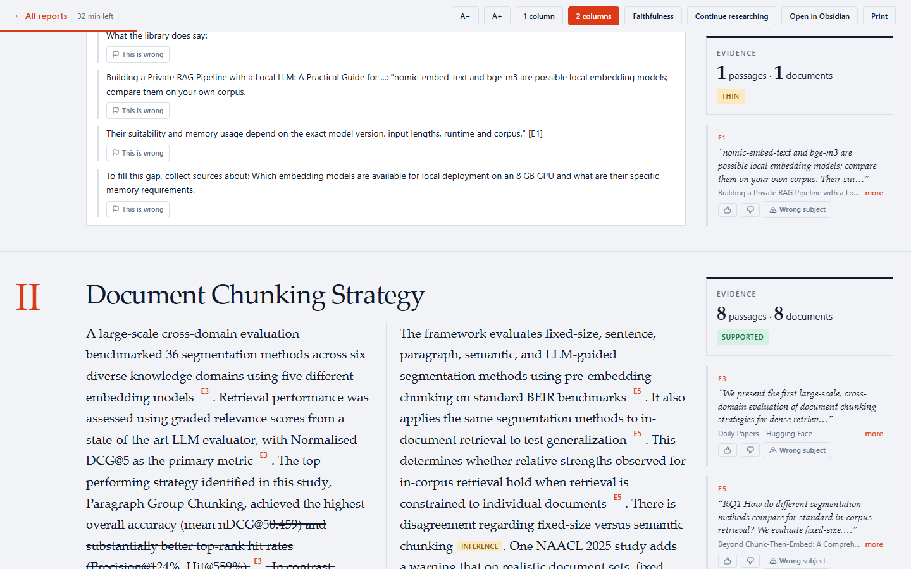

- **The whole report**: at the bottom, **Useful** / **Not useful** and an optional note (*"too generic, wanted
  numbers"*). The note is saved when you leave the box.

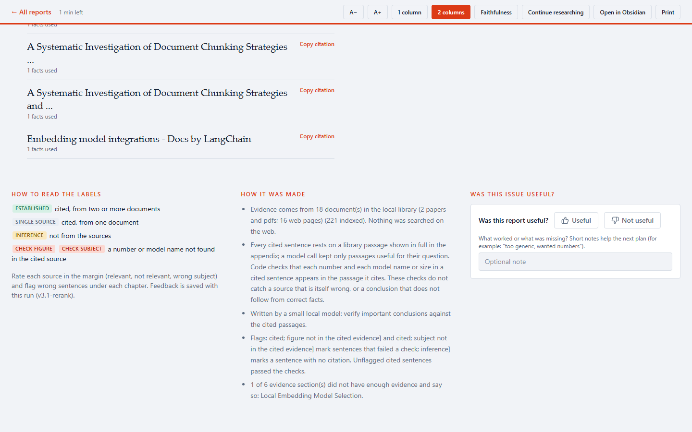

---

## The library

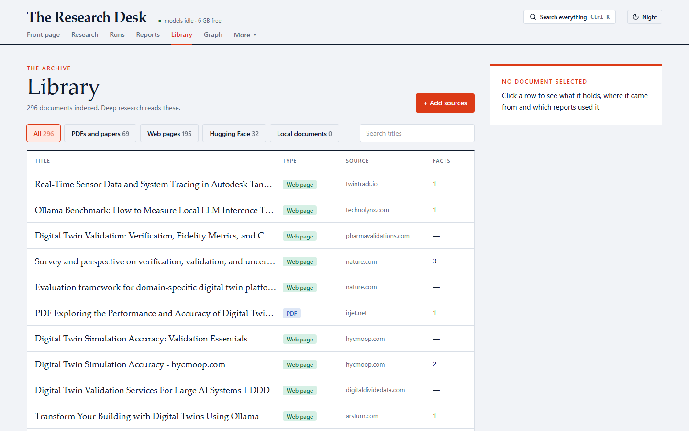

Everything deep research reads. Tabs filter by type (PDFs and papers, Web pages, Hugging Face, Local documents);
**Search titles** narrows the list.

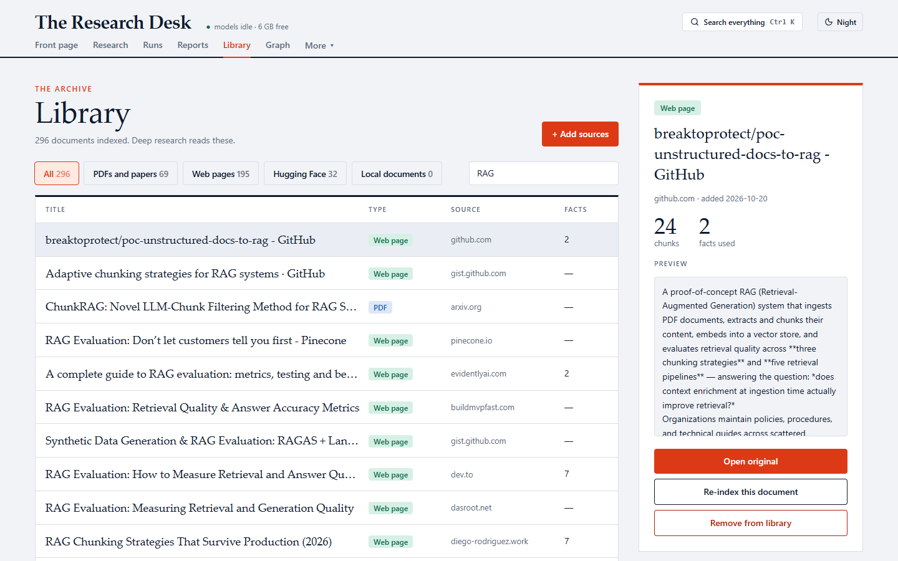

Click a document to see where it came from, how many chunks it has, how many passages reports used, and a preview.
**Open original**, **Re-index this document**, or **Remove from library** (the file moves to the vault's `.removed`
folder; nothing is deleted).

Adding sources:

- **+ Add sources**: paste up to 20 addresses (pages or PDFs). They are fetched (robots.txt respected, paywalled pages
  skipped) and indexed.
- **Your own files**: copy PDF, DOCX, PPTX, HTML, Markdown or text files into `<vault>/Library` (any subfolder). They are
  indexed at the start of the next run, or right away with **Re-index the library** in Settings.

---

## Settings

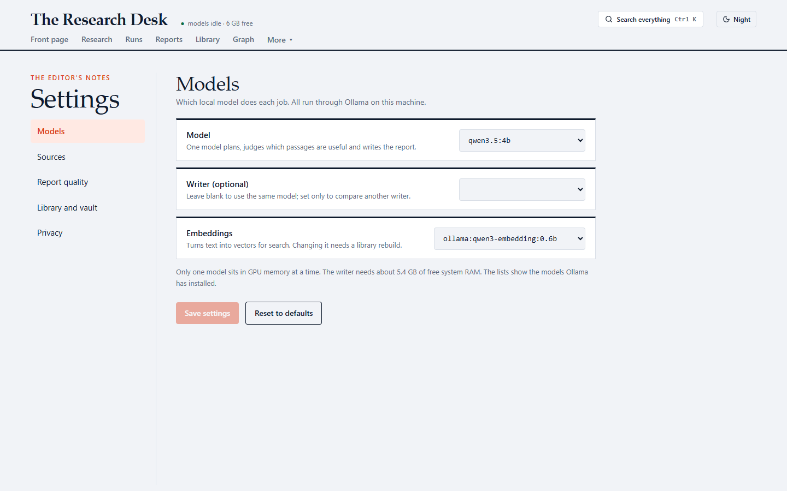

- **Models**: the one model for planning and writing (default `qwen3.5:4b`), an optional separate writer, and the
  embedding model (changing it needs a library rebuild; the button is under *Library and vault*).
- **Sources**: search Hugging Face, AI-engineering sites (click a site to turn it on or off) and Europe PMC (turn this off
  for software topics), and the limit on collected sources.
- **Report quality**: coverage check, sentence checks, *Think when planning* / *Think when writing* (slower, better),
  *Rerank passages*, *Ask me to approve the plan*, *Ask clarifying questions*, and the minimum evidence per chapter.
- **Library and vault**: the vault folder, the library folders, **Re-index the library**, **Rebuild after changing the
  embedding model**.
- **Privacy**: LangSmith tracing (off by default) and the contact email sent when fetching.

**Save settings** writes to the backend's `.env`. **Restart the backend (`langgraph dev`) for changes to take effect.**
Settings not shown here (search backend, allowed/blocked domains, ...) are edited in `.env`; see
[.env.example](../.env.example).

---

## Other pages

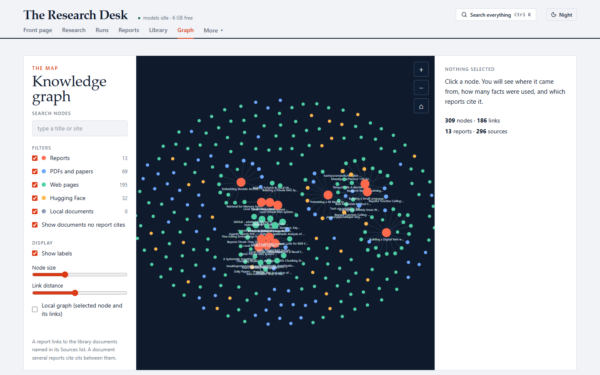

- **Graph** (knowledge graph): reports linked to the documents they cite. Filter by type, search a title, click a node
  for details, *Local graph* to show only one node and its links.
- **Compare issues** (More menu): pick an earlier and a newer report on the same question to see which chapters gained
  evidence, whether the recommendation moved, and which sources arrived or dropped out.
- **Pipeline graph** (More menu): the 12 steps of a run; click a step to see what it reads, writes and which model runs it.

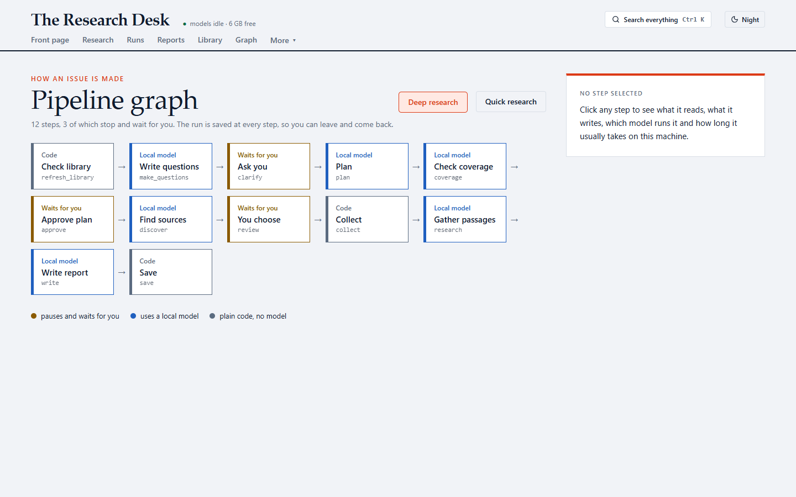

- **Quick research** (More menu): the earlier v1 assistant, a web-search loop that writes a short note in minutes.
  It does not use the library or the sentence checks.
- **Profile** (More menu): a note of your preferences and topics, which you can edit or reset.

---

## Where files go

Everything lives under the folder you set as `VAULT_PATH` (it can be opened as an Obsidian vault):

| Path | What |
|---|---|
| `Research/<date>-<title>.md` | reports (never overwritten; a second one gets `-2`) |
| `Library/<date>-<plan title>/` | sources collected for a run, as markdown, with original PDFs in `raw/` |
| `Library/`, `Sources/` | put your own documents here too |
| `.kb/library.sqlite` | the library index (chunks, keyword index, vectors) |
| `.desk/desk.sqlite` | run traces and all your feedback |
| `.runs/<run id>.json` | run records (status, events, plan) |
| `.removed/` | documents you removed |
| `Profile.md` | the profile note |

Back up the vault folder and you have backed up everything.

---

## Tips

- **First runs**: let it collect sources; later goals on related topics reuse the library and are much faster.
- **Memory**: close browsers with many tabs and other large apps before a run. The front page shows free memory.
- **Speed**: a GPU makes writing 5-10x faster. On a laptop, plug in the charger and use performance mode; a
  power-capped GPU is the most common reason for slow runs (`uv run python scripts/doctor.py` warns about it).
- **Fewer, better sources**: ticking 10-20 good sources beats 100. Large PDFs are the slowest part of collecting.
- **One run at a time**: two runs at once share some state (a known issue).
- **Gaps are useful**: a chapter marked *no evidence* tells you exactly what to collect next; **Collect sources for this
  gap** starts that run.
- **Verify what matters**: every sentence is short and cited. Before acting on a conclusion, click its citation.

### Known issues on the report page

- A `~` in a source passage (as in "~0.45") can show as crossed-out text.
- The *How it was made* box and the *Faithfulness* panel still use the earlier labels (established / single source),
  which v3 reports no longer produce.
